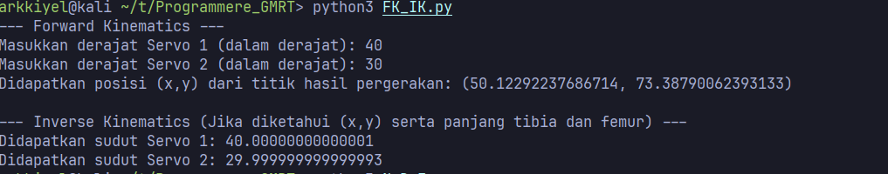
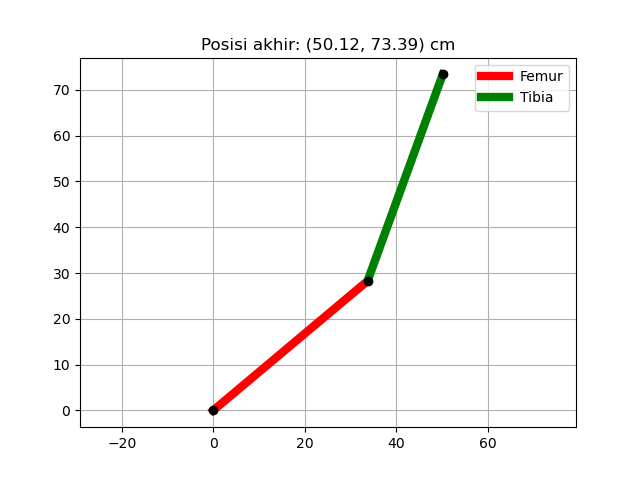
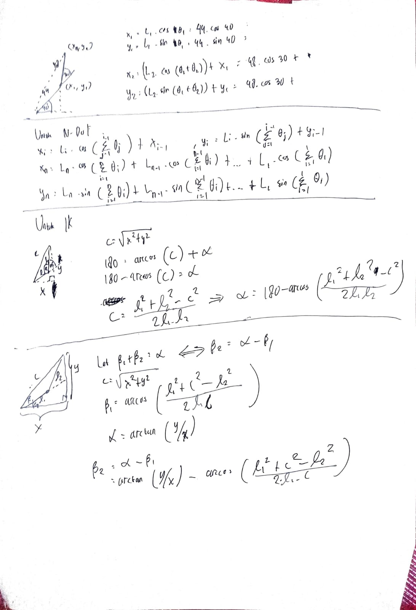
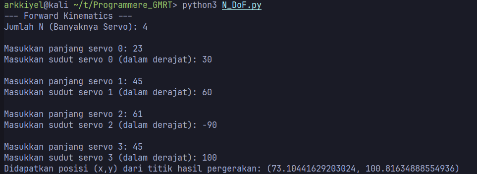
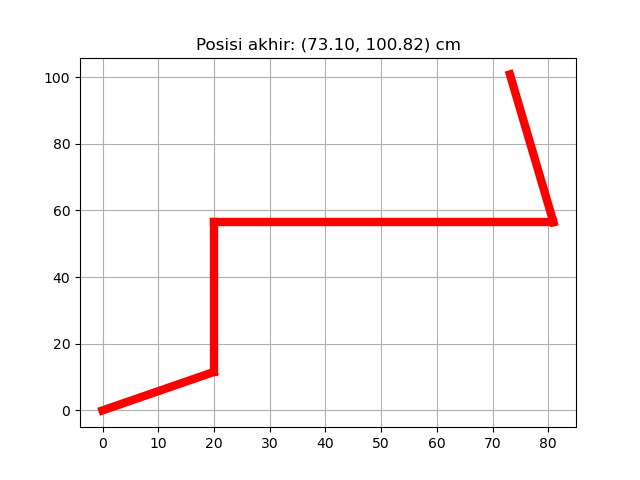

# Forward & Inverse Kinematics 
 
Tugas 2 Open Recruitment Gadjah Mada Robotic Team (GMRT) — Divisi Programmer
 
## Profil
 
| | |
|---|---|
| Nama | Dhimas Arya Cahya Nugraha |
| NIM | `25/559644/PA/23548` |
 
## Deskripsi
 
Program ini adalah implementasi kinematika interaktif berbasis Python untuk kaki robot dua sendi (Femur dan Tibia). Pengguna memasukkan sudut rotasi Servo 1 dan Servo 2 melalui terminal, lalu program menghitung koordinat titik akhir di ujung Tibia. Program juga menyediakan Inverse Kinematics (IK) untuk menghitung kembali kedua sudut servo dari koordinat (x, y) yang diketahui serta visualisasi dengan matplotlib. Selain itu, terdapat program terpisah untuk mengimplementasikan N-DoF.
 
Sudut positif berarti rotasi berlawanan arah jarum jam (CCW), dan posisi 0° adalah saat lengan sejajar sumbu X positif. Sudut Servo 2 diukur relatif terhadap Femur. Titik pusat (0, 0) berada di sendi Coxa, dengan panjang Coxa = 0.
 
Panjang kedua servo yang digunakan berdasarkan NIM:
 
| Link | Sumber | Panjang |
|---|---|---|
| Femur | 2 digit terakhir NIU | 44 cm |
| Tibia | 2 digit terakhir NIF | 48 cm |
 
 
## Tabel Fitur
 
| No | Fitur | Kategori | Status |
|---|---|---|---|
| 1 | Forward Kinematics 2-DoF dengan `input()` interaktif | Wajib | [X] |
| 2 | Hasil test case (Servo 1 = 40°, Servo 2 = 30°) | Wajib | [X] |
| 3 | Mathematical Proof (foto coretan tangan) | Nilai Tambah | [X] |
| 4 | N-DoF  | Nilai Tambah | [X] |
| 5 | Spatial Kinematics (3D: X, Y, Z) | Nilai Tambah | [ ] |
| 6 | Homogeneous Transformation Matrix (NumPy) | Nilai Tambah | [ ] |
| 7 | Visualisasi postur dengan matplotlib | Nilai Tambah | [X] |
| 8 | Inverse Kinematics | Nilai Tambah | [X] |
 

## Hasil Test Case
 
Input: Servo 1 = 40°, Servo 2 = 30°
 
### Output Terminal (FK & IK)
 

 
### Visualisasi Postur
 

## Mathematical Proof
 
Perhitungan manual rumus Forward Kinematics dan Inverse Kinematics:
 

## N-DoF
 
### Output Terminal
 

 
### Visualisasi Postur
 



 
## Cara Penggunaan (How to Run)
 
### Prasyarat
 
- Python 3.10 atau lebih baru
- Library: `numpy`, `matplotlib`

### Langkah-langkah
 
1. Clone repository ini
```bash
git clone https://github.com/USERNAME/NAMA-REPO.git
cd 25-55944-PA-23548_Dhimas-Arya-Cahya-Nugraha_MagangGMRT/
```
 
2. Install library yang dibutuhkan
```bash
pip install -r requirements.txt
```
 
4. Jalankan program untuk kinematika 2 DoF

Untuk Linux/Mac:
```bash
python3 FK_IK.py
```

Untuk Windows:
```bash
python FK_IK.py
```
 
5. Masukkan sudut Servo 1 dan Servo 2 (dalam derajat) saat diminta.

6. Untuk N-DoF, jalankan program dengan
```bash
python3 n_dof.py
```
lalu isi nilai sesuai yang diminta oleh program.


